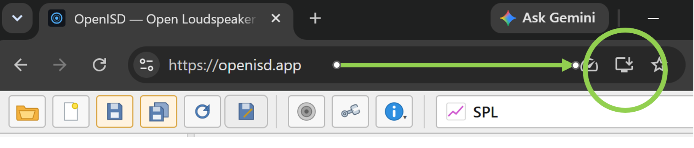
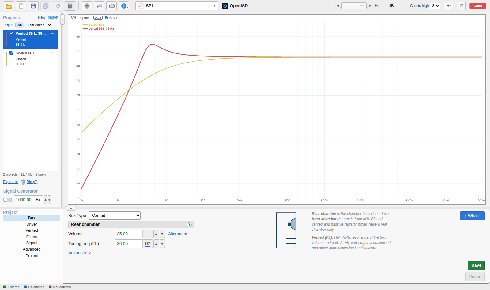
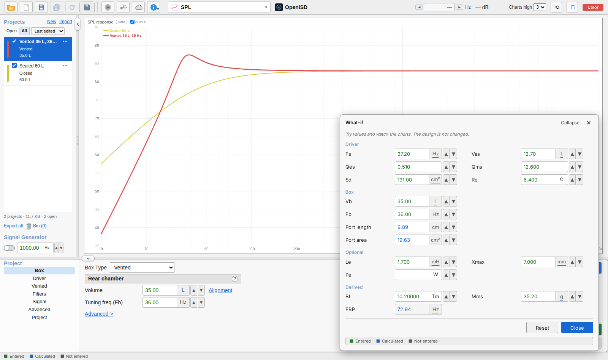
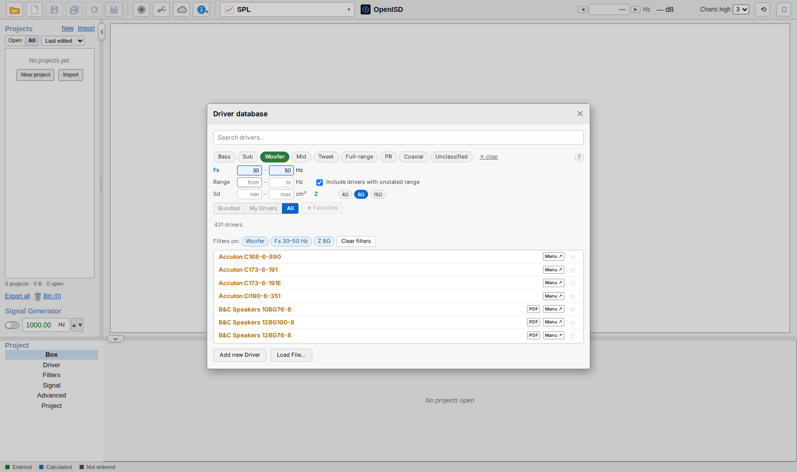

[](https://openisd.app/)

# OpenISD

**An open loudspeaker enclosure simulator that runs in any browser.**

OpenISD designs sealed, vented, bandpass and passive-radiator enclosures from a driver's
Thiele/Small parameters. It reads and writes WinISD's `.wdr` and `.wpr` files. By default it
reproduces WinISD's calculations, and it is checked against files WinISD itself saved.
It is free, open source and needs no install.

> ### ▶ [Launch OpenISD](https://openisd.app/)
>
> There is a desktop version and a mobile version, and both work offline once opened, so there is
> nothing to install. To add it as an app anyway ([all browsers](https://openisd.app/install/)):
>
> - **Chrome or Edge on a computer:** click the install icon at the right end of the address bar.
> - **Chrome on Android:** menu, then Install and create shortcut.
> - **iOS Safari:** choose Share, then Add to Home Screen.
>
> 



Every curve redraws as you type. There is no Calculate button.

## Features

- **Box types:**
  - sealed, vented, 4th-order bandpass, 6th-order bandpass, ABC and passive radiator;
  - round or slotted vents, with a count and an end correction;
  - several drivers, wired in series or parallel, and dual voice coils.
- **Charts:**
  - SPL and transfer function;
  - group delay;
  - cone excursion of the driver and the radiator;
  - impedance magnitude and phase;
  - port air velocity;
  - maximum SPL and maximum power;
  - the filter chain's response;
  - several designs overlaid for comparison;
  - a cursor that snaps to peaks, and can be locked or typed;
  - a help page for each chart on desktop and phone: how to read it and what to fix.
- **Design tools:**
  - WinISD's sealed and vented alignments (QB3, BB4, EBS3, EBS6, C4);
  - vent length from tuning, and tuning from length;
  - radiator mass for a target tuning;
  - an EBP gauge;
  - the filter chain: high-pass, low-pass, all-pass, Linkwitz transform, parametric EQ, shelves,
    static gain and raised cosine;
  - an equation inspector that shows the formula behind a value;
  - a signal generator that plays a tone.
- **Solvers that work in every direction.** Enter what you know and the rest is derived. For
  example, any two of Qts, Qes and Qms give the third.
- **Data-quality marks:**
  - each value shows whether it was entered or calculated;
  - when a driver's own figures contradict each other, the app says which ones.
- **What-if.** Adjust a driver's parameters and the box, and watch the curves respond.
  Nothing is saved; cancel and the design is exactly as it was.
- **Driver library.** 1,917 drivers and 81 passive radiators come bundled, with source links,
  alongside your own saved drivers. Filter by type, Fs, the frequency range the maker states, Sd
  and impedance.
- **Number boxes.** Type a value, use the arrows, or drag left or right on a digit to spin it.
  The digit you press sets the step.
- **Air per project.** Each project has its own temperature, humidity and pressure, which set
  the speed of sound and the air density through WinISD's own air model.
- **Files and sharing:**
  - WinISD `.wdr` and `.wpr`, and OpenISD's own `.owpr` and `.owdr`;
  - share a design as a link;
  - open projects are saved automatically in the browser.
- **Projects.** A Projects panel lists every saved and open project, with search and sort. A
  deleted project goes to a Bin, where you can restore it. Options, "Your data", shows the storage
  used and lists backups you can restore or export.
- **Optional Google Drive sync.** Off until you turn it on. It copies your projects, drivers and
  Options to your own Google Drive and shows what it did. See [Privacy](#privacy).





## OpenISD and WinISD

WinISD, by Linearteam, is the tool this project grew from. It stopped at version 0.7, runs
only on Windows, and its source was never released. OpenISD carries the idea forward.

- **Goal:** by default, OpenISD behaves 100% like WinISD, including its deliberate calculation
  choices. WinISD's linkage bugs (an edit that fails to update what a load would, a crash, data loss) are not copied. Every
  control the two share does what it does in WinISD.
- **Stretch goal:** for interest and education, offer other conventions, such as the textbook
  models, where WinISD departs from them. Each one sits behind its own switch or drop-down in
  the WinISD Compatibility panel. Left untouched, those switches give WinISD's answer.

- **Compatible:**
  - it opens and writes WinISD's files;
  - by default its numbers match WinISD's.
- **Different on purpose:**
  - contradictory inputs are marked, not silently discarded;
  - a typed value is never rewritten behind the user's back;
  - each project keeps its own air conditions.
- **Parity state** (2026-10-21; drivers W5-1138SMF and E150HE-44, radiators ND140-PR and
  SB15SFCR-00): 248 of 269 cells in the
  [WinISD equivalence register](docs/research/WINISD_EQUIVALENCE.md) match WinISD, most to
  ≤ 1e-12. Every chart exists for every box type.
- **Remaining gaps:**
  - not yet compared with WinISD: the readouts sealed Fsc and Qtc, peak impedance,
    bandpass Fr and Ff, and the maximum-power/Xmax crossover.
  - after one typed edit, WinISD and OpenISD differ in these: the number of voice coils (WinISD
    ignores it; sealed box), the driver editor's fLe, KLe, Hc and Hg when the file does not state them
    (sealed, vented and 6th-order bandpass boxes), the vent cross area after more vents are typed
    (vented box), and the passive radiator Vas (WinISD rounds it) and Sd (WinISD ignores it).
  - not yet compared after an edit: a typed vent end correction (vented box).

Details:

- [ARCHITECTURE.md §9–10](ARCHITECTURE.md#9-deliberate-departures-from-winisd): the departures and a feature-by-feature comparison.
- [WinISD equivalence register](docs/research/WINISD_EQUIVALENCE.md): every chart, box and setting, with its measured deviation.
- [Gap list](OPENISD_WINISD_GAPS_AND_BUGS.md): calculation differences still open.

## Run it locally

```bash
npm install
npm run dev        # development server
npm run build      # production build in packages/ui/dist/
npm test packages/design/test/engine/circuit.test.ts   # one test file
```

`npm test` needs a target: a unit test file, or a `*.browser.spec.ts` browser spec. With no target
it stops and says so, because the full suite runs on GitHub Actions for each change that lands on
main. A maintainer can run both suites by setting `OPENISD_FULL_GATE=1`.

## Documentation

| Document                                           | What it covers                                                        |
|----------------------------------------------------|-----------------------------------------------------------------------|
| [ARCHITECTURE.md](ARCHITECTURE.md)                 | Layers, domain model, solving, state, formats, testing, WinISD comparison |
| [RESEARCH.md](RESEARCH.md)                         | The theory, what WinISD is built on, and WinISD's measured behaviour  |
| [OPENISD_WINISD_GAPS_AND_BUGS.md](OPENISD_WINISD_GAPS_AND_BUGS.md) | Open differences from WinISD                             |
| [FEATURES.md](FEATURES.md) · [BACKLOG.md](BACKLOG.md) | Features and planned work                                          |
| [bugs/](bugs/)                                     | Known open bugs                                                       |
| [TESTING_STRATEGY.md](TESTING_STRATEGY.md)         | How the app is tested                                                 |
| [CONTRIBUTING.md](CONTRIBUTING.md)                 | How to contribute                                                     |
| [RELEASES.md](RELEASES.md) · [RELEASING.md](RELEASING.md) | Every release, and how a release is made                       |
| [DOCUMENTATION.md](DOCUMENTATION.md)               | Index of every other document                                         |

## Get involved

Contributions are welcome. Start with [CONTRIBUTING.md](CONTRIBUTING.md) and the
[backlog](BACKLOG.md).

Maintainer: [John Lonergan](https://johnlon.github.io/).

## Privacy

OpenISD keeps your projects and drivers in your browser. Cloud sync is off until you turn it on. When on, it copies your saved projects, drivers, passive radiators, favourites and Options to a hidden folder in your own Google Drive that only OpenISD can open. No OpenISD server sees them. Disconnect stops it.

The app does send anonymous usage counts (launches with device type and screen size, which charts and features are used, box types opened and saved, which catalogue drivers are picked, and errors) to a stats collector; they carry no project data, no account and no raw address. An error report you choose to send also carries the note and contact you type.

## Licence

MIT. See [LICENSE](LICENSE).
