# Plan: the passive radiator's Select, Info and Edit, as the driver's

Task T840 (pull request 140, branch `t840`, label `hold`). Status: approved mock, building.

## Goal

The passive radiator is chosen, inspected and edited the way the driver is, on both skins: a name, then **Select**,
**Info** and **Edit**. Edit opens one passive-radiator editor that has the driver editor's frame, tabs, tools and buttons.
The phone Box tab shows the radiator by name, without its figures; the desktop Passive Radiator page keeps its figures
(WinISD-like).

## John's words (workspace `questions.yml`, QO946)

| Time (UTC) | Id          | Words                                                                                                                                                                                                                                                                         |
| ---------- | ----------- | ----------------------------------------------------------------------------------------------------------------------------------------------------------------------------------------------------------------------------------------------------------------------------- |
| 11:05      | QO946.c115  | "I want an editor for the pr, it must have the fields the current editor has, it must have a save to my prs option as well as ok and cancel, the numbers must disappear from the mobile box page but remain on the desktop as per now as that is more WinISD like, I still want the select pr popup and in the select popup to have a button to the new pr popup" |
| 11:18      | QO946.c116  | "stop, show me the new design"                                                                                                                                                                                                                                                |
| 11:42      | QO946.c117  | "we need the same select info edit setup and workflow as the driver / please mock"                                                                                                                                                                                           |
| 12:46      | QO946.c118  | "looks ok, btw the labels on sections aren't consistent "driver" in the driver page and "user options" on the pr page, make both User options - I think this is mobile only, so check"                                                                                    |
| 12:47      | QO946.c119  | "and on the Info page show the Type: Passive Radiator / to be affirmative"                                                                                                                                                                                                  |
| 12:51      | QO946.c120  | "ok build this and write a plan for it including these mock screens first"                                                                                                                                                                                                  |
| 14:03      | (board)     | "if there is only one field then keep it with the other fields" (on the General tab holding only the name)                                                                                                                                             |
| 12:57      | (board)     | "I think the pr screen should show Key Figures too on the page next to the user options like the driver - the mms is important as users stick to the 1.5 added mass guide, also fs I guess, anything else humans might want to see? xmax and displacement so they can check the 2x rule?" |

Earlier rulings kept: QO946.c37 (the Define button works, like the driver editor); QO946.c38 (the radiator's own figures
belong to the radiator; the build choices, number of radiators, added mass and tuning, stay project settings and are not in
the editor).

## The mock screens (approved 12:46), beside the driver's today

Pictures are the worktree's app at 390 x 844 (phone) and 1280 x 720 (desktop). The mock's Export, Import, Reset and tick
boxes were not wired yet; the build wires them.

| Driver today                                                                                 | Passive radiator (mock)                                                                       |
| -------------------------------------------------------------------------------------------- | --------------------------------------------------------------------------------------------- |
| 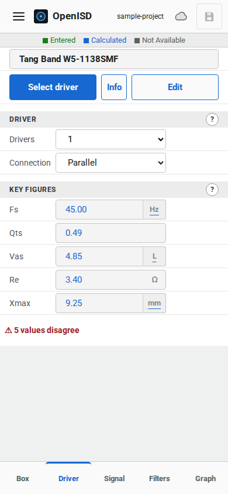 Phone Driver tab: name box (opens Select), Select driver / Info / Edit, then the choices | 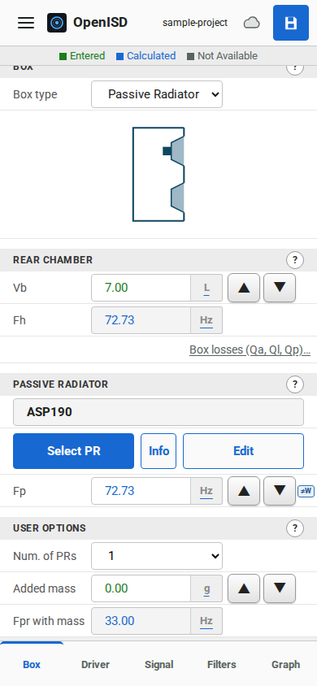 Phone Box tab: name box (opens Select), Select PR / Info / Edit; no radiator figures; Fp and User options stay |
| 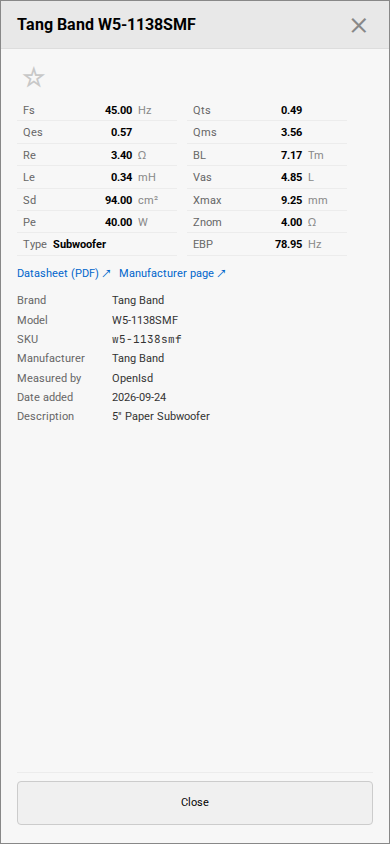 Phone driver Info               | 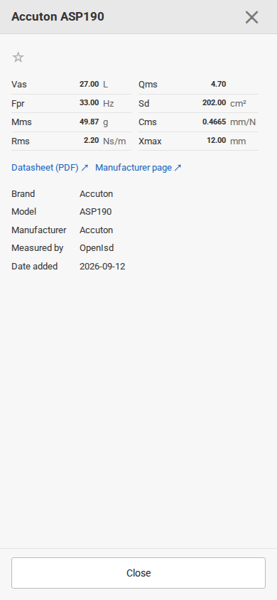 Phone radiator Info: name, star, the eight figures, links, identity, Close (gains the Type row) |
| 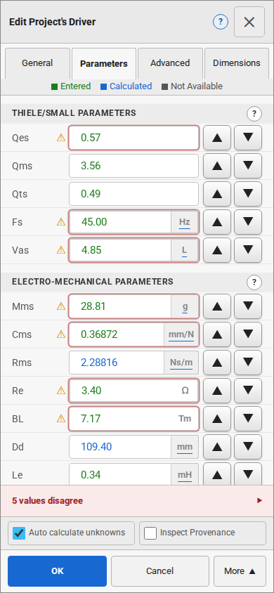 Phone driver editor             | 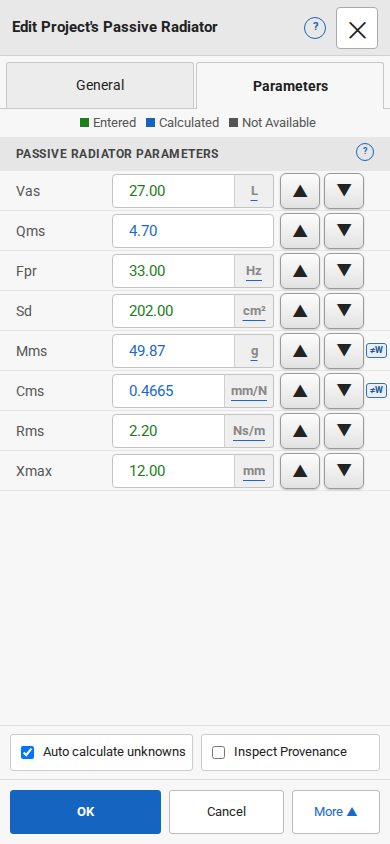 Phone radiator editor: ? and X, General / Parameters tabs, legend, the eight figures with steppers, Auto calculate unknowns, Inspect Provenance, OK / Cancel / More |
| (driver More menu: Export, Import, Copy to My Drivers, Reset)                               | 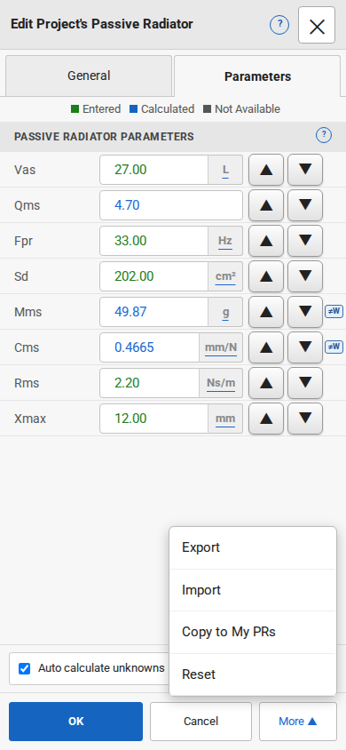 More: Export, Import, Copy to My PRs, Reset |
| 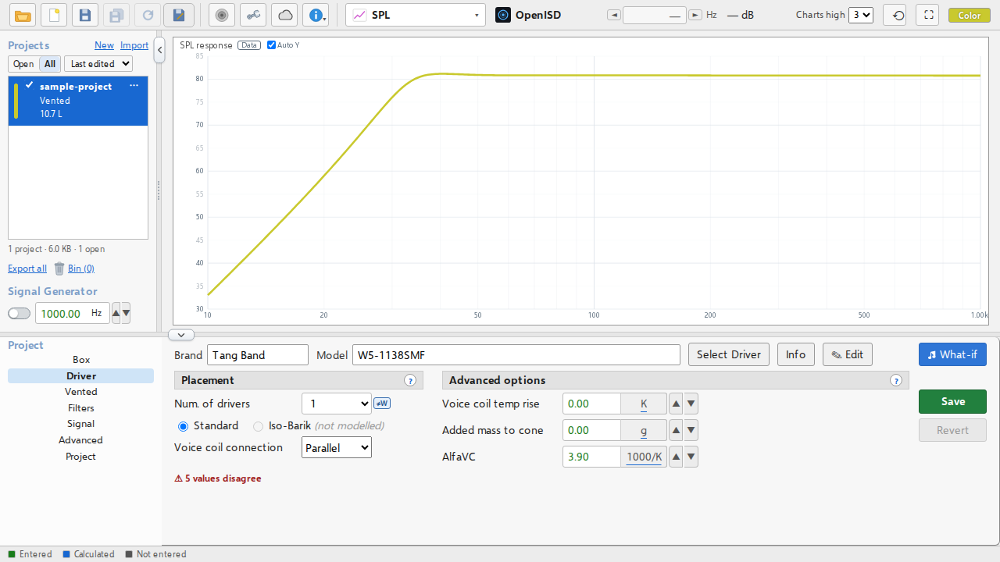 Desktop Driver page             | 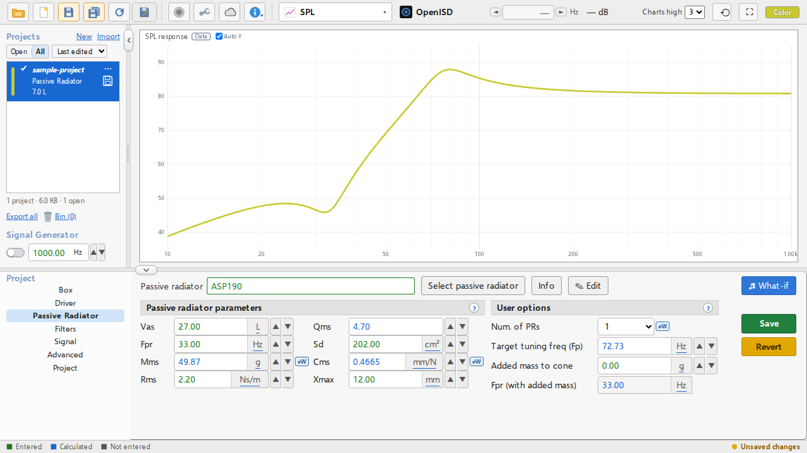 Desktop Passive Radiator page: figures stay; name, Select passive radiator / Info / Edit |
| 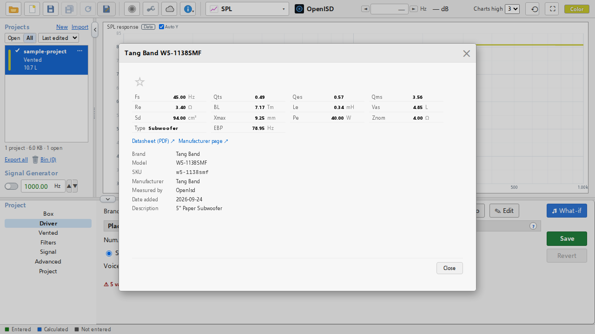 Desktop driver Info             | 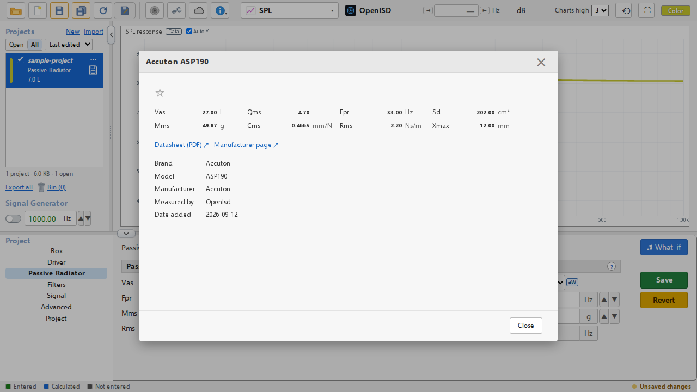 Desktop radiator Info (gains the Type row) |
| 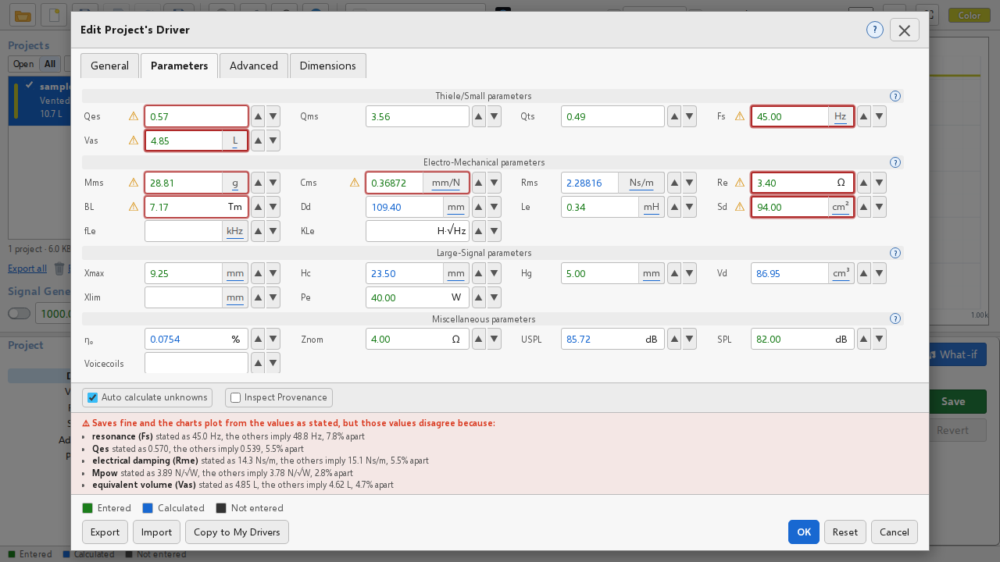 Desktop driver editor           | 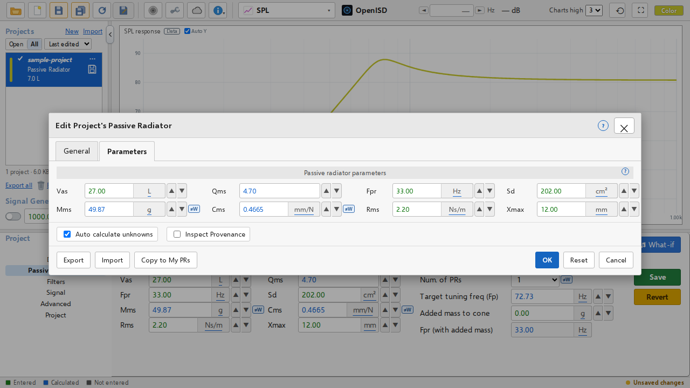 Desktop radiator editor: Export / Import / Copy to My PRs left, OK / Reset / Cancel right |

## What changes

Phone:

- Box tab, Passive radiator section: the name box (tap opens Select), then **Select PR / Info / Edit**, then Fp. The eight
  figure rows go. The "Save to library" button goes (its job is Copy to My PRs in the editor). User options (Num. of PRs,
  Added mass, Fpr with mass) stay.
- Driver tab: the band over Drivers and Connection is headed **User options**, as the radiator's (QO946.c118).

Desktop:

- Passive Radiator page: figures unchanged. The row is name, **Select passive radiator / Info / ✎ Edit**; "Save to library"
  goes (Copy to My PRs in the editor).
- Section names: the desktop Driver page heads the driver's choices "Placement"; the Passive Radiator page heads its
  "User options". Reported to John, not renamed (QO946.c118 asked for the phone only unless told).

Both skins:

- **Info**: read only, laid out as the driver's Info: name, star, Vas, Qms, Fpr, Sd, Mms, Cms, Rms, Xmax, a **Type: Passive
  Radiator** row where the driver shows its Type (QO946.c119), links, Brand / Model / Manufacturer / Measured by / Date added
  / Description, Close.
- **Edit**: "Edit Project's Passive Radiator", the driver editor's frame. Tabs General and Parameters. General holds the
  fields the radiator record carries, as the driver editor's General tab: Manufacturer, Brand, Model (the radiator's name),
  Data provided by, Date added, Comment (John, 14:03 UTC: "if there is only one field then keep it with the other fields";
  the record carries these, so the tab stays). Parameters (the eight
  figures, ≠W cues on Mms and Cms as the page). Auto calculate unknowns (on by default), Inspect Provenance (tap a figure: is
  it entered or calculated, and the formulas from the radiator's own figures that give it). OK puts the edits in the project;
  Cancel and X drop them; Reset puts back what the editor opened with; Copy to My PRs files a copy in My passive radiators
  and says so; Export writes an `.owdr` file through the system save dialog and says so; Import reads one back into the
  editor and says so. Desktop footer: Export, Import, Copy to My PRs | OK, Reset, Cancel. Phone footer: OK, Cancel, More
  (Export, Import, Copy to My PRs, Reset).
- **Select**: the passive radiator library popup, unchanged, with "+ Define new passive radiator", which opens the same
  editor on a blank radiator ("Define new passive radiator", General tab, name focused). OK makes it the radiator in use and
  closes the popup; Copy to My PRs files it and the popup's Saved list shows it at once.
- **New Project wizard, radiator step**: Define opens the same editor; OK makes it the wizard's radiator.

PR 140 behaviour changed: its editor's OK filed a defined radiator in the library only. John's spec (QO946.c115) makes OK
apply to the project, and Copy to My PRs file it.

## Phone Box tab: Key figures for the radiator (John, 12:57 and 12:58 UTC)

The phone Box tab's radiator part gains a read-only **Key figures** section, as the phone Driver tab's KEY FIGURES (drvref-1),
next to User options. Rows, each the common field in its read-only plain form, tapping one opens the editor (as the
driver's):

| Row                        | What it shows                                                                                   | Kind                    |
| -------------------------- | ----------------------------------------------------------------------------------------------- | ----------------------- |
| Fpr                        | the radiator's own resonance (Fs)                                                               | the radiator's figure   |
| Mms                        | moving mass, for the "added mass" guide                                                         | the radiator's figure   |
| Sd                         | cone area                                                                                       | the radiator's figure   |
| Xmax                       | excursion limit                                                                                 | the radiator's figure   |
| Vd                         | the radiator's displacement, Sd × Xmax, so the user can hold it against the driver's (the "2×" rule of thumb) | calculated (blue) |

John, 12:58 UTC: "ok show vd not as them": the displacement itself, not a PR / driver ratio (dropped).

**The 2× rule line** (John, 13:00-13:01 UTC): under the radiator section, one calculated line in plain words, not hidden in
help: "2× rule: radiators need ≥ 174 cm³ — 1 of these is enough" or "... — needs 3 of these". The count is the smallest
whole number N with N × radiator Vd ≥ 2 × number of drivers × driver Vd. Hand-worked for the sample project: driver Tang
Band W5-1138SMF Vd 86.95 cm³, one driver, so radiators need ≥ 173.9 cm³ (shown 174); ASP190 Vd = 202 cm² × 12 mm =
242.4 cm³, so 1 is enough. The engine works out the count (`PrEngine.countForTwiceDisplacement`); the words come from
`packages/design` fields. The line is empty when a Vd is missing. Desktop: proposed, the same line under the desktop
radiator parameters; not changed until John says.

Calculations live in the engine, never in the UI: the radiator Vd is an engine function (`PrEngine.displacement`). A
missing input (no Sd or no Xmax) leaves the row empty, as any calculated box with nothing to work from (QO424).

Proposed, not built (John to decide): an "Added mass / Mms" row (added mass ÷ Mms, as "N.NN ×") would let a user check the
"1.5× added mass" guide he named. It is a plain ratio of two figures the page already shows; the plan does not invent a
limit or a warning for it.

Desktop: the Passive Radiator page already shows Fpr, Mms, Sd and Xmax (the numbers stay, WinISD-like); it does not show
Vd. Not changed without John's word.

Spec: pr-editor (phone) "the Box tab shows Key figures: Fpr, Mms, Sd, Xmax and Vd" and "the 2× rule line"; engine unit
tests for the radiator Vd and the count.

## Behaviours and the specs that prove them

Browser specs (both skins unless named): `packages/ui/test/ui/pr-editor.browser.spec.ts`,
`packages/ui/test/ui/pr-define.browser.spec.ts`. Unit: `packages/ui/test/hooks/passiveRadiatorEditor.test.ts`,
`packages/ui/test/hooks/passiveRadiatorActions.test.ts`, `packages/ui/test/hooks/PRBrowser-hooks.test.ts`,
`packages/design/test/fields/phoneText.test.ts`.

| Behaviour                                                                  | Spec                                                                                         |
| -------------------------------------------------------------------------- | -------------------------------------------------------------------------------------------- |
| Editor holds name and the eight figures, the driver editor's buttons, no build choice | pr-editor: "the editor holds every radiator figure ..."                             |
| OK applies the edits to the project                                        | pr-editor: "OK applies ..."; passiveRadiatorActions: "Edit opens the editor ..."            |
| Cancel drops the edits; Reset puts back what it opened with               | pr-editor: "Cancel discards ..., and Reset ..."; passiveRadiatorEditor: "Reset ..."          |
| Copy to My PRs files a copy, says so, project changes only on OK          | pr-editor: "Copy to My PRs ..."; passiveRadiatorEditor: "Save to My PRs files a copy ..."    |
| Export writes `.owdr` and says so; Import reads it back and says so       | pr-editor: "Export writes ..."; passiveRadiatorEditor: "Export writes ..."                   |
| Auto calculate unknowns on / off                                           | pr-editor: "Auto calculate unknowns ..."; passiveRadiatorEditor: "Auto calculate ..."        |
| Inspect Provenance says entered/calculated and the radiator's formulas    | pr-editor: "Inspect Provenance ..."; passiveRadiatorEditor: "Inspect Provenance ..."         |
| Info shows the radiator, Type: Passive Radiator, read only                 | pr-editor: "Info shows the radiator, affirmed as a passive radiator ..."                     |
| Phone Box tab: name, Select PR / Info / Edit, no figures, choices stay    | pr-editor (phone): "the Box tab shows the radiator by name ..."                             |
| Desktop page keeps its figures, Select / Info / Edit                      | pr-editor (desktop): "the Passive Radiator page keeps its figures ..."                      |
| Phone Driver tab band reads User options                                   | pr-editor (phone): "the Driver tab's choices are headed User options"; phoneText.test        |
| Define opens the editor on a blank radiator; OK uses it; Copy files it    | pr-define (desktop, phone, wizard step); passiveRadiatorActions: "Define new ..."            |
| The popup's Saved list shows a copy at once                                | PRBrowser-hooks: "the Saved list re-reads the library when the editor saves"                 |

Also run before shipping: every browser spec naming the radiator popup, the PR page and tab, the wizard's radiator step,
the driver editor and the phone Driver tab; typecheck, lint, the unit tests the change reaches, every architecture test,
`bash scripts/visual/compare-local.sh`. Changed baselines are re-drawn by CI only (`bash scripts/visual/update.sh`).

## Out of scope

- Renaming the desktop Driver page's "Placement" section (reported to John instead).
- A WinISD-format radiator file: Export and Import use OpenISD's `.owdr` only (WinISD has no radiator file to match).
- The driver editor's Dimensions and Advanced tabs, its "values disagree" bar and its provenance colouring by path: the
  radiator has no such data yet.
- Moving the build choices (count, added mass, tuning) anywhere (QO946.c38).

## Order of work

1. This plan with the mock screens (pushed first).
2. Failing specs on the PR 140 branch, seen red for the right reason.
3. Editor tools in the hook (Reset, Auto calculate, Inspect Provenance, Export/Import, Copy to My PRs) with unit tests.
4. The editor component, the Info view (with Type), both pages, the phone Driver tab band.
5. The wizard's radiator step.
5a. Phone Key figures (the engine's Vd first, with a unit test; then the section and its spec).
6. Checks; the final pictures `preditor-*.png` with captions; task file and pull request text.
